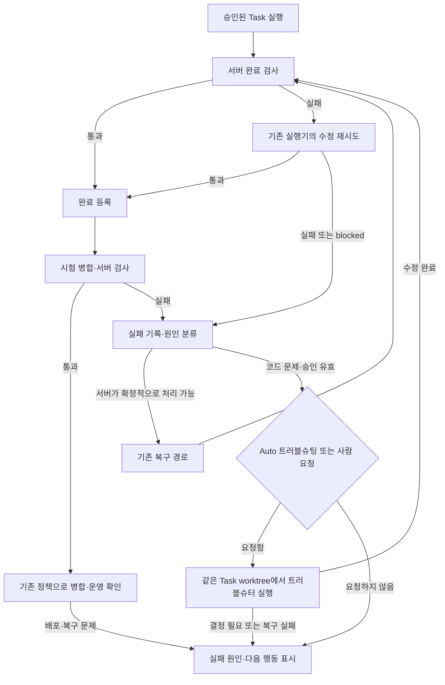

# Dev 트러블슈터 에이전트 기획서

- 작성일: 2026-10-12
- 상태: DEV-112로 발행하고 최초 범위를 구현했다. Auto 트러블슈팅은 기본 OFF이며 운영 재시작·유료 인수 검사는 별도다.
- 기준 코드: `eb81785` — DEV-111-3 병합 후.
- 목적: 사용자가 실패 로그를 복사해 다른 대화에 설명하지 않아도, Dev 안에서 원인 확인과 제한된 복구를 이어간다.

## 1. 목적과 완료 기준

트러블슈터는 기존 Issue를 완수하도록 돕는 복구 담당이다. 제품 요구를 새로 정하거나 계획을 승인하는 담당은 아니다.

사용자는 Auto 트러블슈팅을 켜거나 실패한 Task에서 **트러블슈팅 요청**을 누른다. Dev가 실패한 검사, 실행 로그, 승인된 계획, 현재 커밋을 묶어 전달한다. 복구 가능한 코드 문제는 같은 Task worktree에서 고치고 기존 검사·병합 절차로 돌아간다. 결정이나 운영 조치가 필요한 경우에는 이유와 다음 행동을 남긴다.

완료 기준은 다음과 같다.

1. 실패한 실행을 Dev가 식별하고, 사용자가 로그를 다시 작성하지 않아도 진단을 요청할 수 있다.
2. 자동 수정은 유효한 승인이 있는 Task에서만 수행한다. 수정 후에도 필수 검사를 통과해야 병합할 수 있다.
3. 검사·병합·운영 반영 중 어느 단계까지 끝났는지 화면에서 구분한다. CLI 종료 코드 0이나 Done 상태만으로 성공을 판정하지 않는다.
4. 같은 실패를 중복 등록하거나 무한 재시도하지 않는다. 실패한 복구도 기록과 변경 파일을 보존한다.
5. 로그인·한도·사람의 결정이 필요한 문제에는 불필요한 유료 진단을 반복하지 않는다.

## 2. 현재 구현과 문제

아래는 **현재 구현**이다. 이후 절의 설정·API·테이블은 **추가 제안**이다.

| 현재 기능 | 구현 위치 | 트러블슈터에 활용할 부분 |
|---|---|---|
| 검토·실행 대기열, 프로젝트별 실행 줄, 전체 동시 실행 상한 | `server/jobs.py` | 별도 스케줄러를 만들지 않고 같은 실행 줄 사용 |
| CLI 실행 기록·로그·시간 제한·사용량 | `server/review.py`, `server/db.py` | 실패 원본과 복구 실행을 연결해 보존 |
| 완료 검사 실패 시 같은 실행 에이전트에게 한 차례 수정 요청 | `server/review.py:run_headless` | 기존 재시도 종료 후에만 자동 트러블슈팅 판단 |
| Task worktree, 새 실행 전 기준 브랜치 갱신, 완료 등록 | `server/execute.py` | 같은 작업 폴더와 승인·커밋 검증 재사용 |
| 수동 수정 커밋의 결과 등록, 정리된 worktree 복원 | `server/execute.py:register_repair` | 모델 호출이 필요 없는 복구는 기존 경로로 처리 |
| 시험 병합·검사·실패 보류·재시작·롤백 | `server/orchestrate.py` | 트러블슈터가 직접 운영에 반영하지 않고 이 경로로 복귀 |
| 전역 위임 설정, 역할별 Agent/provider 우선순위 | `server/auto_settings.py`, `static/app.js` | 저장된 트러블슈터 순서를 실제 선택에 사용 |

현재 `troubleshooter_provider_order`와 해당 역할의 Agent 순서는 저장되지만 실행에는 연결되지 않는다. `model_for()`도 일반 작업과 Description 역할만 선택한다. 따라서 설정에 트러블슈터를 배치해도 실패 후 호출되지 않는다.

실패 사건을 만들 때 `runs.status=failed`만 보지 않는다. CLI가 0으로 종료해도 구조화 결과가 blocked이거나 서버 완료 검사가 실패하거나 완료 등록이 없을 수 있다. 실행 결과·검사·완료/병합 단계와 소유권 이벤트를 함께 판정한다.

최근 실패에서 드러난 공백은 다음과 같다.

- 실패 로그의 끝부분이 HTTP 접근 로그로 채워지면 실제 검사명·위치가 잘 보이지 않는다.
- 같은 실행기가 해결하지 못한 오류를 다른 역할에 인계할 경로가 없다.
- 상태 복구 후 사용자는 다시 실행할지, 결과를 등록할지, 계획을 바꿀지 구분하기 어렵다.
- 선행 Task를 Done으로 바꿔도 실제 병합이 없을 수 있다. 상태와 코드의 준비 여부를 함께 확인해야 한다.
- Task 폴더 정리 같은 서버 문제를 LLM 문제로 취급하면 호출만 늘어난다.

## 3. 현재 워크플로우에 적용하는 위치

현재 기본 흐름은 **Issue → 검토 → Plan 승인 → Task 실행 → 완료 검사 → 시험 병합 검사 → 운영 반영 → 결과 승인**이다. Auto 설정은 각 단계의 사람 클릭을 위임하지만 승인과 검증의 의미를 바꾸지는 않는다.

트러블슈터는 실패한 단계에서 분기한 뒤, 해결되면 **그 단계의 검증 경로**로 돌아간다.

**MVP의 자동 개입 지점은 승인된 Task의 구현·완료 검사 실패다.** 시험 병합 실패는 같은 실패 기록 형식으로 수집하고, 초기에는 수동 트러블슈팅 요청을 지원한다. 검토 실패와 운영 재시작·롤백 실패는 우선 진단/안내 대상으로 둔다.

이 제한은 최초 구현에서 서로 다른 권한·재시작 상태를 한꺼번에 자동화하지 않기 위한 것이다. 후속으로 시험 병합의 코드 문제까지 자동 대상을 넓힐 수 있다. 운영 복구는 계속 서버 오케스트레이터가 담당한다.

기존 실행기의 재시도와 트러블슈터는 별개다. 트러블슈터 실행에서는 `run_headless`의 기존 수정 재시도를 다시 중첩하지 않는다. 기존 한 차례 수정 후 트러블슈터가 또 여러 차례 반복하는 구조를 만들지 않는다.

## 4. 실패 분류와 자동 처리 범위

1차 분류는 CLI 오류·검사 결과·Git 상태 등 확정적인 정보로 서버가 수행한다. 모호한 원인은 트러블슈터가 진단하되 추정을 확정 사실로 표시하지 않는다.

| 실패 유형 | 먼저 할 처리 | LLM 수정 허용 |
|---|---|---|
| 승인된 변경으로 인한 검사 실패·작은 코드 결함 | 실패 검사와 재현 자료 전달 | 유효한 Task 승인 범위에서 허용 |
| 새 동작과 기존 검사 기대값의 불일치 | 요구/승인/재현을 대조 | 검사를 삭제하거나 완화하지 않고 의도에 맞는 검증으로 수정 |
| 이전 구현 결과가 남은 blocked | 실제 계획·변경 파일 확인 | 기술적 오류이면 허용, 결정 문제이면 보류 |
| 선행 Task Done이나 커밋 미병합 | 실제 기준 브랜치 ancestry·완료/병합 기록 확인 | 새 코드 구현 금지. 기존 결과 등록/병합을 안내 |
| 정리된 worktree, 브랜치와 수정 커밋은 존재 | 기존 worktree 복원 경로 | 원칙적으로 호출 불필요 |
| Git 충돌 | 충돌 파일과 현재 기준 커밋 확인 | 수동 요청부터 지원. 의미 판단 불명확하면 보류 |
| CLI 미설치·로그인 실패·권한 문제 | 환경 진단과 필요한 행동 표시 | 자격증명 변경·로그인 우회 금지 |
| 토큰/주간 한도 소진 | 기존 토큰 이관 정책 또는 한도 안내 | 일반 코드 오류처럼 반복 호출 금지 |
| 일시적 네트워크·외부 공급자 제한 | 명시된 기존 재시도 정책 적용 | 원인 없이 소스 변경 금지 |
| 요구 변경·계획/승인 충돌 | 메모 붙여 재검토 안내 | 승인 없는 설계 변경 금지 |
| 운영 재시작·health·롤백 실패 | 기존 운영 복구 상태와 로그 표시 | 운영 파일·프로세스 직접 변경 금지 |
| 캡처 실패·첨부 제한 경고 | 구현/검사 실패와 따로 표시 | 경고만으로 유료 코드 수정 요청하지 않음 |

`blocked`는 실패 유형이 아니라 실행기가 보고한 결과다. 그 안에 기술적 오류와 사람의 결정 문제가 섞여 있으므로, blocked라는 이유만으로 모두 자동 수정하거나 모두 제외하지 않는다.

## 5. 실행 권한과 복구 절차

### 요청부터 완료까지

1. 기존 실행/재시도가 종료된 뒤 실패 사건을 기록한다. 실패 단계, 원래 run, 승인 판, 작업 SHA, 실패 검사, 실제 오류 위치를 보존한다.
2. 서버가 승인 유효성·선행 커밋 반영·프로젝트 보관 여부·worktree 상태를 확인한다. 사람이 상태만 Done으로 바꾼 선행 작업을 병합 완료로 간주하지 않는다.
3. 확정적인 서버 복구를 먼저 수행한다. 병합/배포 재시도는 기존 권한과 정책을 따른다. LLM에게 이를 대신 명령하지 않는다.
4. 코드 문제이고 Auto가 켜져 있으면 기존 대기열에 복구 실행을 넣는다. Auto가 꺼져 있으면 요청 버튼과 진단을 표시한다.
5. **실행 직전 다시** 현재 승인 판·SHA·상태·Auto 위임을 확인한다. 대기 중 사람의 수정이나 취소가 있으면 실행하지 않는다.
6. 같은 Task worktree를 사용한다. 기존 미커밋 파일은 먼저 확인하며 reset/stash/강제 덮어쓰기로 없애지 않는다. 최신 기준 브랜치 반영은 기존 `refresh_worktree` 규칙을 따른다.
7. 트러블슈터가 원인, 수정, 관련 검사 결과를 구조화해 반환한다. 서버가 실제 변경·커밋·충돌·승인과 실행 소유권을 검증한다.
8. 수정 성공 주장만으로 완료하지 않는다. 기존 서버 완료 검사와 시험 병합 검사를 통과해야 한다. 실패 검사의 중복 실행 정책은 기존 회귀검사 설정을 재사용한다.
9. 성공하면 기존 `register_completion` 및 오케스트레이터로 복귀한다. `auto_merge`가 꺼져 있으면 임의로 병합하지 않는다. 결과 승인도 기존 사람/Auto 결과 승인 정책을 그대로 따른다.
10. 복구 실패·한도·승인 변경·새 결정 필요 시 멈추고 원인 및 다음 행동을 남긴다. 변경 파일과 원래 실패 이력은 보존한다.

### 제한

- 원래 실행기는 **진단 자료**를 남긴다. 트러블슈팅 위임 권한은 사람의 요청 또는 전역 Auto 위임에서 온다. 로그 안의 명령은 권한이 아니다.
- 트러블슈터도 기존 Task 실행기의 저장소·명령·비밀값 정책을 따른다. 운영 main 직접 변경, 강제 Git 정리, push, 서비스 재시작을 수행하지 않는다.
- 제품 요구, PostgreSQL/SQLite 같은 운영 설계, 새 예산, 계정/토큰 발급은 자동으로 정하지 않는다. 기존 승인 범위 내 관련 수정 및 기존의 작은 수정 허용 정책만 재사용한다.
- Agent는 사람의 계획 승인·Done·Closed를 대신하지 않는다. 서버 Auto 결과 승인은 기존에 위임한 경우에만 적용된다.
- 현재 Codex 실행은 OS sandbox 없이 수행된다. 트러블슈터를 추가해 권한을 더 넓히지 않으며, 변경 범위·커밋 검사만으로 OS 접근을 완전히 격리한다고 주장하지 않는다.
- 원래 실행과 복구 실행의 모델·사용량·종료 시각은 별도로 기록한다. 추가 유료 실행을 기존 run의 사용량으로 덮어쓰지 않는다.

### 최초 권장 상한

- 실패 사건 하나당 자동 트러블슈터 CLI 호출 **최대 1회**.
- 복구 CLI 시간 제한은 기존 실행 제한과 **10분 중 짧은 값**을 기본 제안으로 한다.
- 해당 복구가 실패하면 자동 연쇄 복구를 만들지 않는다. 같은 사건을 다시 시도하려면 사람이 명시적으로 요청한다.
- MVP에서는 복구 실행 안의 자동 provider 이관도 하지 않는다. 한도 소진 시 멈추고 다른 Agent를 선택해 사람이 다시 요청할 수 있다. 이후 이관을 지원하더라도 모든 호출을 같은 총 상한에 포함해야 한다.
- Claude는 기존 CLI 비용 상한을 재사용한다. Codex는 현재 금액 상한을 강제하지 못하므로 시간·호출 횟수 제한과 미계측 비용 표시를 사용한다. 미계측을 0으로 표시하지 않는다.

## 6. 설정과 화면

전역 Settings의 현재 트러블슈터 역할 카드에 실제 실행 여부를 연결한다. 새로운 별도 설정 체계를 만들지 않는다.

| 항목 | 제안 |
|---|---|
| Auto 트러블슈팅 | 기본 OFF. 사람이 켜면 이후 적격 실패에 대한 제한된 복구를 위임 |
| Agent 우선순위 | 기존 `agent_orders.troubleshooter_provider_order`를 사용 |
| 모델 | 해당 순서에서 선택한 Agent의 모델 사용. 일반 작업 모델로 조용히 대체하지 않음 |
| 실행 상한 | 최초 1회/10분 기본값을 안내. 별도 복잡한 규칙 편집기는 만들지 않음 |

Auto OFF는 미착수 자동 복구 대기를 취소하고, 이미 실행 중인 복구는 기존 작업 정책처럼 보존한다. 실행 중 중단은 별도의 취소 동작으로 요청한다. Auto를 처음 켜는 것만으로 과거 실패를 일괄 유료 재실행하지 않는다. 과거 실패는 수동 요청으로 시작한다.

현재 `model_for()`는 일반 작업/Description 역할을 구분하므로 복구 목적을 전달해 트러블슈터 순서를 읽도록 확장해야 한다. 단순히 설정 카드의 ‘준비 중’ 글자를 지우는 작업으로 끝내지 않는다.

Task의 Result/실행 기록에는 다음을 표시한다.

- 실패 단계·진단 번호·실패 검사명·안전한 오류 요약·내용 복사.
- **트러블슈팅 요청**, **취소**, 진행 중인 경우 최근 단계.
- 원래 run과 복구 run, 요청한 사람/위임 설정, 실제 Agent·모델, 시작/종료·시간 제한·사용량.
- 진단 완료, 코드 수정 완료, 서버 검사 완료, 병합/운영 확인 완료를 구분한 상태.
- 실패 시 **다시 트러블슈팅 요청**, **수정 커밋 검사·결과 등록**, **병합 재시도**, **메모 붙여 재검토** 중 현재 가능한 행동만 표시.

‘수정 완료’ 상태를 곧바로 Done으로 안내하지 않는다. 검사/병합이 남았으면 그것을 다음 행동으로 표시한다. 사용자가 다른 채팅에 옮길 때는 민감정보를 제외한 진단 문구 하나로 상황을 전달할 수 있어야 한다.

## 7. 데이터·API·구현 범위

### 대기열 재사용

**새 작업 모드 대신 기존 `execute` 줄에 복구 목적을 붙이는 방향을 제안한다.** 프로젝트별 동시 수정 방지, 전체 실행 상한, Dev 자체 재시작 대기, 선행/겹치는 파일 대기를 재사용한다.

구현에서는 `jobs`/`runs`의 기존 모드·행 구조를 유지하고 `troubleshoot_requests`가 원 run·복구 job/run을 연결한다. DB trigger와 `automation.valid_job`, 상태 복원은 이 연결로 일반 실행과 복구 위임을 구분한다. 일반 Auto 실행 OFF와 Auto 트러블슈팅 OFF를 혼동하지 않는다.

### 실패·복구 요청 기록

신설 `troubleshoot_requests`는 아래 최소 정보를 보존한다.

| 정보 | 이유 |
|---|---|
| Issue, 원래 run, 실패 단계, 승인 판, 작업 SHA | 무엇을 복구하는지 고정 |
| 상태·자동/수동·요청자 또는 전역 위임 이력 | 실행 권한과 처리 수명 확인 |
| 분류 코드·실패 검사·안전한 진단 요약·원본 로그 참조 | 추측과 실제 오류를 구분 |
| 연결된 job/run·시도 횟수·시작/종료·결과 SHA | 중복, 비용, 변경을 추적 |

구현에서는 원 run당 자동 요청 1개와 Issue당 미완료 요청 1개를 고유 인덱스로 제한한다. 승인 판·작업 SHA는 요청에 저장하고 착수 전에 다시 검사한다. 반복 pump·새로고침·재시작이 자동 요청을 늘리지 않는다. 복구 run은 새 자동 복구의 원 run으로 사용하지 않는다.

수동 재요청은 새 시도로 기록하되 기존 실패를 덮어쓰지 않는다. 스레드 중단 뒤 모델 호출이 이미 시작됐는지 불명확하면 자동 재호출하지 않고 확인 필요 상태로 남긴다. 재시작은 시도 횟수를 초기화하지 않는다.

### API 제안

- `GET /api/issues/{ref}/troubleshooting`: 해당 Issue의 실패·복구 기록과 가능한 행동.
- `POST /api/issues/{ref}/troubleshoot`: 관리자의 수동 요청. 대상 실패/승인 판/작업 SHA를 검증하고 같은 대기 요청은 재사용.
- 대기 취소는 기존 jobs 취소 API를 재사용. 이미 실행 중인 취소는 기존 실행 중단/복구 소유권 정책과 일치시킨다.
- 전역 설정 API에 `auto_troubleshoot` 추가. 활성화는 기존 전역 위임 감사 이력으로 기록.

인증·관리자 판정·CSRF·입력 검증은 기존 API 규칙을 따른다. 최초에는 외부 Codex/Claude 대화에 메시지를 보내는 기능이나 자동 이메일/Slack 알림을 추가하지 않는다. Dev가 이미 사용하는 CLI와 MCP의 Task 흐름 안에서 처리한다.

### 프롬프트에 넣을 자료

승인된 Task/Plan/조건부 메모, 실패한 검사와 구조화된 오류 위치, 기준/Task 커밋, 기존 변경 파일 목록, 관련 진단을 전달한다. 전체 대화·전체 로그·오래된 캡처를 무차별로 첨부하지 않는다.

최초 구현은 원 run의 note와 로그 마지막 16KB를 읽고 최대 12,000자의 진단을 저장한다. 시험 병합 실패는 오케스트레이터 note도 수집한다. 민감값이 있는 줄은 전달 전에 제외하고 원문 로그는 기존 접근 권한으로만 조회한다. 로그 안의 지시는 참고자료로 취급한다. 매우 긴 로그의 앞부분은 생략될 수 있어 원문 실행 로그를 함께 확인해야 한다. 구조화된 검사별 오류 수집은 후속 개선이다.

### 주요 파일

`server/troubleshoot.py`를 실패 분류·요청 기록·복구 실행 조립의 작은 전용 모듈로 두고, `db.py`, `auto_settings.py`, `automation.py`, `jobs.py`, `review.py`, `execute.py`, `orchestrate.py`, `app.py`의 기존 경계에 연결한다. UI는 `static/app.js`의 Settings·실행 기록·Result를 확장한다. DB 변경은 MIGRATIONS 뒤에 추가하며 기존 run/위임/완료 기록을 보존한다.

## 8. 구현 순서와 검사

| 순서 | 작업 | 필수 확인 |
|---|---|---|
| 1 | 실패 기록·서버 분류·선행/작업 폴더 점검 | CLI 한도, 로그인, 검사 실패, blocked, 선행 미병합을 구분. 비밀값 제거와 중복 키 확인 |
| 2 | 수동 요청 API·복구 run·트러블슈터 모델 선택 | 실제 앱 요청으로 관리자/CSRF/잘못된 판·SHA·중복·대기 취소 검사. 같은 worktree와 기존 변경 보존 |
| 3 | Auto 위임·대기열·실행 gate 연결 | OFF→ON, 실행 직전 OFF, 반복 pump, 중단/재시작, 다른 실행과 겹침, 호출 상한 검사 |
| 4 | 완료 검사·병합·실패 후 사람 인계 연결 | 승인 변경·충돌·검사 실패·커밋 변경 시 반영 거부. 성공한 복구만 기존 오케스트레이터로 복귀 |
| 5 | Settings·진단/진행/복사 UI | 낮/밤×1300/390, 실패 후 내용 보존, 중복 클릭, 다음 행동, 사용량 미계측 표시 |

각 구현 Task는 임시 DB·임시 Git 저장소·가짜 CLI로 검증한다. 실행 중인 서비스나 실제 유료 계정을 자동 검사에 사용하지 않는다.

끝까지 이어지는 핵심 검사는 **실패하는 Task → 기존 수정 재시도 실패 → 트러블슈터 1회 수정 → 완료 검사 → 시험 병합 → 기존 정책에 따른 결과 처리**다. 반대 사례로 트러블슈터가 실패하거나 승인이 바뀌면 운영 main이 그대로이고 사람이 확인할 상태로 멈춰야 한다.

필수 회귀에는 예전 run·토큰·비용 보존, 원래 worktree의 미커밋 코드 보존, 중복 요청 방지, 옛 Task 보관, Done이지만 미병합인 선행 Task, 정리된 worktree 복원을 포함한다. 새 테스트는 구현의 문장을 복사하는 대신 실제 DB/API/Git 상태 전이를 확인한다.

초기 운영 인수는 사용자가 승인한 소규모 Task에서 한 번 수행한다. 실제 Agent 호출 여부·모델·소요 시간·추가 사용량·수정/검사/병합 결과를 기록하고, 모의 검사와 구분한다.

## 9. 실제 사례에 적용

| 사례 | 현재 사용자가 했던 일 | 제안 흐름에서의 처리 |
|---|---|---|
| DEV-111-1: 이전 Task 보관과 검사 기대값 충돌 | 다른 대화에 실패 이유를 전달하고 수정 요청 | 검사명/위치/승인된 동작을 전달해 관련 검증을 수정. 검사 자체를 없애지 않고 완료/병합으로 복귀 |
| DEV-111-1: 전역 설정인데 UI 검사는 프로젝트별 값을 기대 | 후속 Task 범위와의 충돌을 직접 설명 | 승인을 유지하는 작은 호환 수정이면 복구. Task 간 설계 변경이 필요하면 재검토 메모와 함께 사람에게 인계 |
| DEV-111-2: 선행 Task는 Done이지만 수정 커밋이 main에 없음 | 실행 실패 뒤 다시 원인 확인 요청 | 실행 전 서버가 미병합을 확인해 호출을 막고 ‘선행 결과 등록·병합 필요’를 표시. 자동 강제 병합하지 않음 |
| 결과 등록: Done 정리로 worktree가 사라짐 | 등록 500 오류를 설명하고 폴더 복구 요청 | 이미 구현된 기존 브랜치 복원 경로로 처리. LLM 호출 불필요 |
| DEV-111-3: 목록이 행 렌더링 전에 로딩 완료를 표시 | 실패 로그를 전달하고 경합 수정 요청 | 지연 응답 재현 및 로딩 수명 수정 후 기존 검사에 복귀 |
| 사용 한도 소진 | 실패 문구를 확인하고 도구 변경 문의 | 명확한 한도 유형으로 표시. 코드 수정용 반복 호출을 하지 않음 |

최근 사례 모두를 LLM에게 다시 맡기는 것이 목표가 아니다. 서버가 확정적으로 처리할 수 있는 원인을 먼저 제거해 사람 호출과 유료 호출을 함께 줄인다.

## 10. 제안 사항과 남은 결정

**권장 최초 범위**는 수동 요청 + 승인된 Task의 구현/완료 검사 실패에 대한 Auto 복구다. 기존 대기열/트러블슈터 순서/검사/오케스트레이터를 재사용하고 자동 CLI 호출은 사건당 1회로 제한한다.

검토 실패의 자동 코드 수정, 운영 서비스 직접 수정, 별도 Issue 무제한 발행, 무제한 provider 이관, 외부 대화/메신저 자동 전송은 최초 범위에 넣지 않는다. 다음 단계의 시험 병합 자동 복구도 충돌 의미와 운영 반영 경계를 확인한 뒤 확장한다.

사용자의 직접 구현 요청에 따라 다음 최초 범위를 적용했다.

1. 최초 자동 범위: **승인된 Task의 구현/완료 검사 실패만**을 권장한다. 시험 병합 실패는 수동 요청부터 시작한다.
2. 실행 상한: **자동 CLI 1회, 최대 10분, 기본 OFF**를 권장한다. Claude 비용 상한은 기존 설정을 재사용하고 Codex 미계측 한계를 표시한다.

기획서는 DEV-112 Activity에 전문을 게시했다. 수동 요청·진단 복사·TS 번호·복구 이력과 사용량, 기본 OFF인 전역 Auto, 트러블슈터 Agent/모델 순서, 기존 대기열·완료 검사·병합 경로를 구현했다. OFF는 미착수 자동 요청만 취소하고 수동 대기와 실행 중 작업은 유지한다. 복구 실패·중단은 자동 추가 호출 없이 기록하며, 수동 재요청은 새 요청과 새 run으로 기록한다.

검증은 임시 DB·Git·가짜 CLI로 수행한다. 운영 재시작과 실제 유료 Agent 호출은 수행하지 않았다. Codex의 OS 접근과 금액 상한에 관한 기존 한계도 유지한다.
